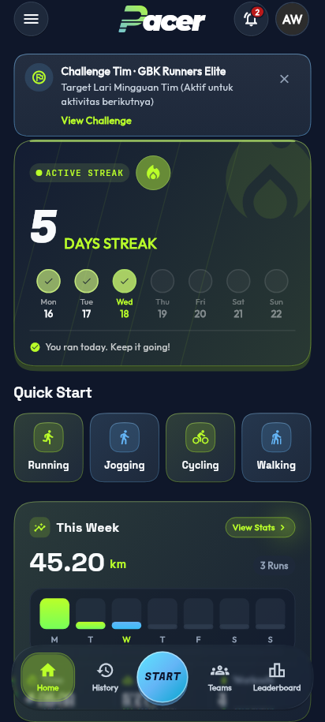
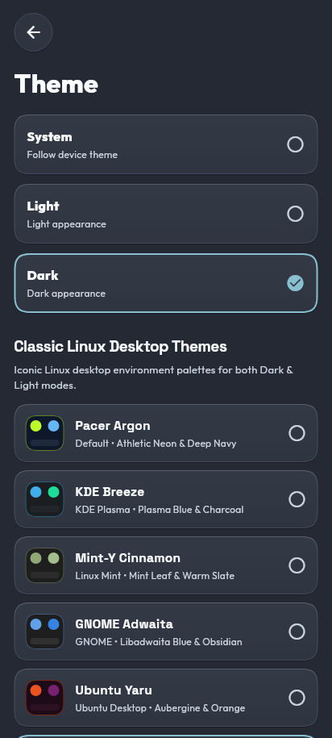

# Pacer

Offline-first running and multi-sport tracker built with Flutter and Supabase.

[](https://github.com/Lemondeft/pacer/releases)
[](LICENSE)

  

## Download

Get the latest Android APK (with QR code and SHA-256 verification) from the [Pacer Download Page](https://lemondeft.github.io/pacer/), or grab builds directly from [GitHub Releases](https://github.com/Lemondeft/pacer/releases).

> **No account needed to test:** Select **Try Demo Account** on the Welcome or Login screen to launch a local SQLite sandbox with sample workouts, teams, and challenges. It resets automatically on logout.

## Features

**Tracking & Maps**
- Records **Running**, **Jogging**, **Cycling**, and **Walking** with live pace, distance, duration, and calories.
- Writes active workout drafts continuously to disk so crashes or killed processes don't drop sessions.
- Vector maps via OpenFreeMap (`Positron` / `Dark`) with toggleable street labels and post-run route summaries.
- Dashboard with 7-day volume/pace stats, leaderboard rank, recent history, and quick-start buttons.

**Clubs, Challenges & Coaching**
- Public clubs and invite-code private teams with real-time chat.
- Solo and team challenges that tally qualifying workouts automatically.
- Role-based views and permissions for **Admin / Coach**, **Captain (*Ketua*)**, and **Member (*Anggota*)**, including PE coach grading boards and member notifications.

**Interface & Localization**
- Floating glass navigation bar rendered with Impeller (`liquid_glass_easy`).
- Light, Dark, and System modes with Linux desktop color palettes: **Pacer Argon** (default), **KDE Breeze**, **Mint-Y Cinnamon**, **GNOME Adwaita**, **Ubuntu Yaru**, and **Arch Nord**.
- Full **English (`EN`)** and **Indonesian (`ID`)** UI translations.

## Architecture

Pacer treats local SQLite as the primary source of truth (`LocalStore`) rather than waiting on network calls:

1. **Local storage:** Workouts, drafts, and cached views read/write directly to SQLite using a stale-while-revalidate pattern.
2. **Outbox sync:** Offline writes queue in a local outbox and sync to Supabase once a connection is available.
3. **Database access:** Supabase PostgreSQL enforces Row Level Security (RLS) across workouts, team chat, and coach grading records.

| Layer | Stack |
| :--- | :--- |
| Client | Flutter (Android, iOS, Linux, Windows, macOS, Web) |
| Backend | Supabase (PostgreSQL, Auth, Realtime, RLS, Edge Functions) |
| Local DB | `sqflite`, `sqflite_common_ffi`, `shared_preferences` |
| Maps | `flutter_map`, `flutter_map_vector_tiles` (OpenFreeMap / OSM) |
| UI | `liquid_glass_easy`, `google_fonts` |

## Development

### 1. Setup

```bash
git clone [https://github.com/Lemondeft/pacer.git](https://github.com/Lemondeft/pacer.git)
cd pacer
flutter pub get
cp .env.example .env
```

Fill in `SUPABASE_URL` and `SUPABASE_ANON_KEY` in `.env` (leave `SUPABASE_SERVICE_KEY` empty for client builds).

### 2. Supabase

Link your Supabase project, push migrations from [`supabase/migrations/`](supabase/migrations), and deploy the activity validator Edge Function:

```bash
supabase db push
supabase functions deploy validate-activity
```

### 3. Run

```bash
flutter analyze
flutter test
flutter run
```

## License

[GNU General Public License v3.0](LICENSE)
