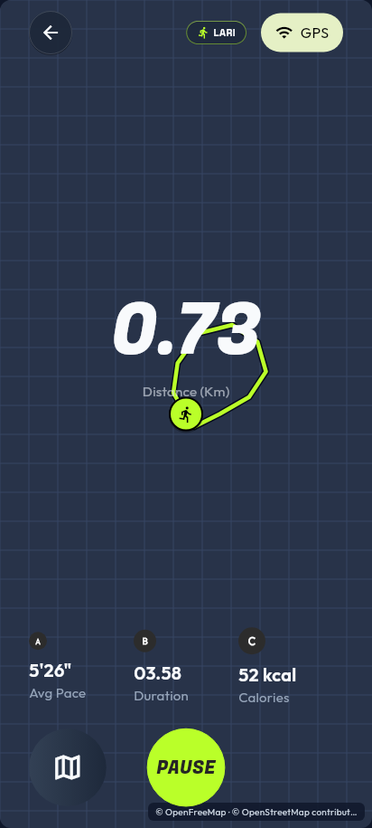

<div align="center">
  

  # Pacer

  **Offline-first sports & running tracker built with Flutter and Supabase.**

  [](https://github.com/Lemondeft/pacer/releases)
  [](LICENSE)
  [](https://flutter.dev)
  [](https://supabase.com)

  [Download](#-download) • [Features](#-features) • [Screenshots](#-screenshots) • [Architecture](#-architecture) • [Quick Start](#-quick-start) • [License](#-license)
</div>

---

## 📦 Download

Pre-built release binaries featuring the Pacer speed-cut brand icon are available on [**GitHub Releases**](https://github.com/Lemondeft/pacer/releases).

> **Try without signing up:** Launch the app and select **Demo Account** on the login screen to explore all features offline with pre-populated workouts, teams, and challenges.

---

## ✨ Features

### 🏃 GPS & Multi-Sport Tracking
- **4 Dedicated Activity Modes:** Track **Running**, **Jogging**, **Cycling**, and **Walking** with live pace, distance, duration, and calorie metrics.
- **Crash-Safe Draft Recovery:** Active sessions persist continuously so unexpected app closures never lose workout progress.
- **Distraction-Free Vector Maps:** Powered by **OpenFreeMap** (`Positron` in Light mode, `Dark` in Dark mode) with a one-tap street-label toggle and full-bleed post-run route summaries.

### 📊 Athletic Dashboard & Liquid Glass UI
- **At-a-Glance Telemetry:** Quick-start sport grid, 7-day volume and pace overview, personal leaderboard standing, and recent workout history.
- **Impeller Liquid Glass Navigation:** Floating navigation pill (`liquid_glass_easy`) featuring optical edge-border refraction and chromatic dispersion.

### 🏆 Clubs, Challenges & Coach Grading
- **Running Clubs:** Join public teams or create invite-code private clubs with built-in real-time team chat.
- **Solo & Team Challenges:** Automatic workout contribution toward active challenge slots and shared team goals.
- **Role-Based Workflows:** Tailored permissions and views for **Admin / Coach**, **Captain (*Ketua*)**, and **Member (*Anggota*)**—including dedicated PE coach grading boards and member notifications.

### 🎨 Themes & Localization
- **Adaptive Appearance:** Supports **Dark**, **Light**, and **System** theme modes.
- **Classic Linux Desktop Palettes:** Switch between **Pacer Argon** *(default)*, **KDE Breeze**, **Mint-Y Cinnamon**, **GNOME Adwaita**, **Ubuntu Yaru**, and **Arch Nord** across both Dark and Light variants.
- **Bilingual Support:** Full **English (`EN`)** and **Indonesian (`ID`)** localization.

---

## 📸 Screenshots

> *Tip: Replace these placeholders with actual app captures from `docs/screenshots/` to showcase the Liquid Glass UI and Linux themes.*

| Dashboard & Liquid Glass | Live GPS Tracking | Linux Palettes & Challenges |
| :---: | :---: | :---: |
|  |  |  |

---

## 🏗️ Architecture

Pacer is designed as an **offline-first** client backed by a multi-tenant relational database:

1. **Local Single Source of Truth (`LocalStore`):** All workouts, drafts, and cached views read/write directly to SQLite (`sqflite` on mobile, `sqflite_common_ffi` on desktop) using a stale-while-revalidate strategy.
2. **Background Outbox Sync:** Offline mutations queue safely in a local outbox and synchronize automatically with Supabase once network connectivity returns.
3. **Database Security:** Supabase PostgreSQL enforces strict **Row Level Security (RLS)** policies across user workouts, team chats, and coach grading records.

### Tech Stack

| Layer | Technologies |
| :--- | :--- |
| **Framework** | Flutter (`Android`, `iOS`, `Linux`, `Windows`, `macOS`, `Web`) |
| **Backend & Auth** | Supabase (`PostgreSQL`, `Auth`, `Realtime`, `Row Level Security`) |
| **Local Persistence** | `sqflite`, `sqflite_common_ffi`, `shared_preferences` |
| **Maps & Routing** | `flutter_map`, `flutter_map_vector_tiles` (OpenFreeMap / OSM) |
| **Shaders & Typography** | `liquid_glass_easy` (Impeller optical shaders), `google_fonts` |

---

## 🚀 Quick Start

### 1. Clone & Configure Environment

```bash
git clone [https://github.com/Lemondeft/pacer.git](https://github.com/Lemondeft/pacer.git)
cd pacer
flutter pub get
cp .env.example .env
